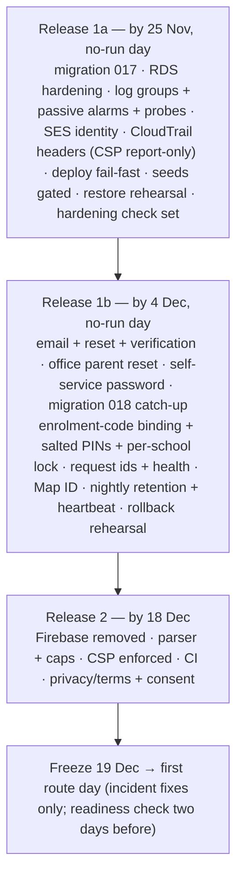
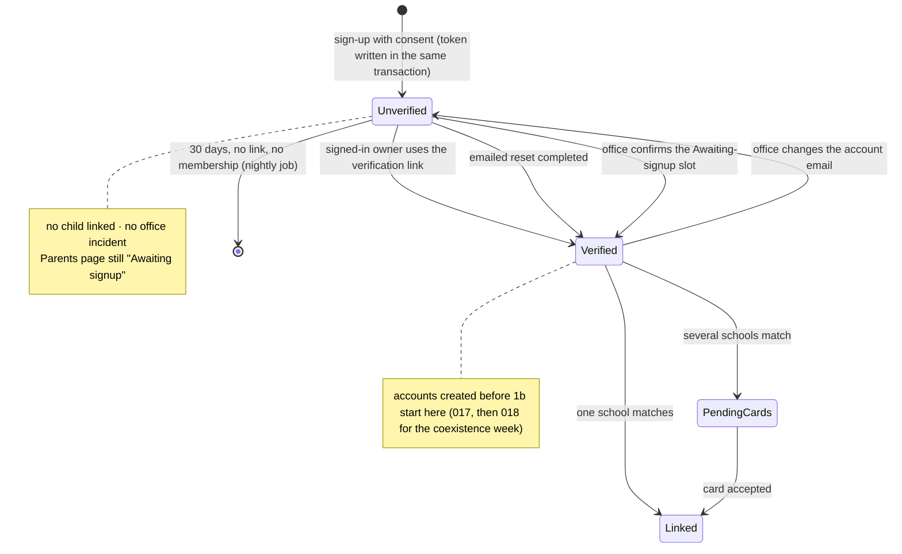
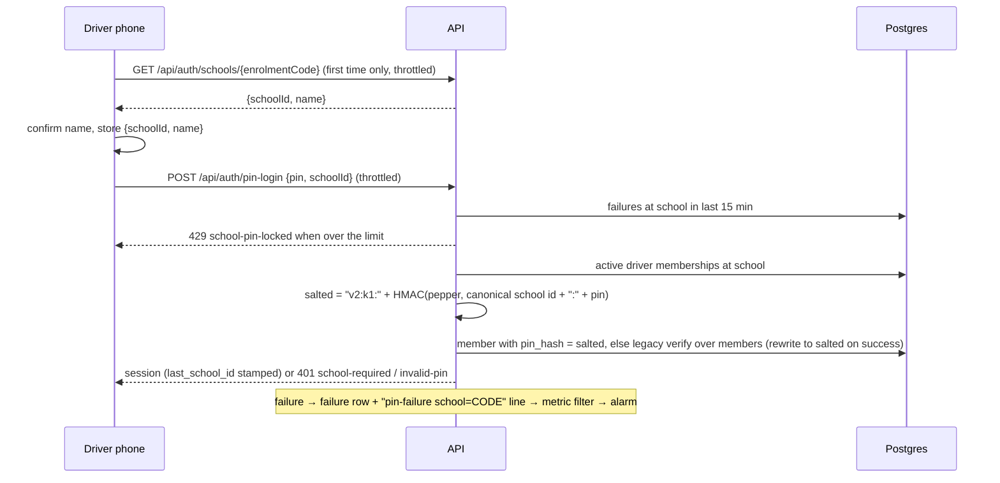
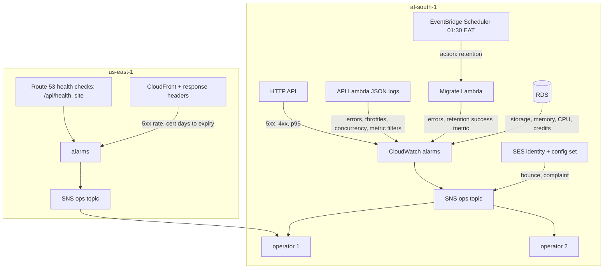

# feat: Production hardening for the January go-live

## Summary

Three deploys before the 19 December freeze close the gaps the November readiness assessment found. Release 1a (schema and platform) lands migration 017, the alarms and uptime probes, the hardened database, the fail-fast deploy and the security headers in report-only mode. Release 1b (code) brings parent password recovery by email and by the office, verified sign-up, driver sign-in bound to one school with per-school PINs and a per-school lock, request-id error logging, a database-aware health check, the production Map ID and the nightly retention job. Release 2 drops the Firebase path and the vulnerable spreadsheet parser, enforces the content-security policy, adds CI, and ships the privacy and terms surfaces with Kuumbai's text.

---

## Problem Frame

The platform has run a pilot since mid-2026 and is technically sound at its core, but the first paying school arrives in January and the assessment of 2026-11-15 found first-week failures waiting: a parent who forgets a password reads "Check your email" and nothing arrives, because nothing in the platform sends email; one global 4-digit PIN space signs a driver in to any school and the collision message confirms other schools' PINs; nobody is told when production breaks, unexpected errors leave no log line, and the health check never touches the database; the single-AZ database has deletion protection off and a restore that was never rehearsed, while the deploy script regenerates the master password and the PIN pepper on a region mismatch. Smaller edges are open too: no security headers, public API docs, vulnerable frontend dependencies in a Firebase path production never used, Google's demo Map ID, retention that runs only after a Start Run, no privacy or terms surface, no CI. The requirements doc fixes what must be true; this plan fixes how, in what order, and with what proof (see origin: docs/brainstorms/2026-11-16-production-hardening-requirements.md).

---

## Requirements

Carried from the origin document; the right-hand column names the units that satisfy each.

| ID | Requirement | Units |
|---|---|---|
| R1 | Transactional email from the SafeRide domain, failures visible to operators | U1, U4, U7, U12 |
| R2 | Forgot-password emails a single-use link expiring within an hour; the screen never claims a mail it did not send | U7 |
| R3 | Either staff role issues a parent a one-time temporary password (shown once, 72 h, forced change, other sessions ended, audited) | U2, U9 |
| R4 | A new parent account links no child and is unknown to schools until its email is verified; resend offered | U7, U8 |
| R5 | Pre-release parent accounts keep their links and are never asked to verify | U2, U8 |
| R6 | Cross-school pending cards unchanged once verified | U8 |
| R7 | Any signed-in user can change their own password from the app | U9 |
| R8 | No screen or guide promises an email the platform does not send | U8, U13 |
| R9 | Driver signs in by PIN on a phone bound to one school via link, QR or code | U10 |
| R10 | PINs unique within a school; no message reveals another school's PIN | U10 |
| R11 | Office shows the school link, QR and code; driver guide explains first sign-in | U10, U13 |
| R12 | PIN on an unbound phone refused with the instruction | U10 |
| R13 | Existing drivers keep PINs; first sign-in after release binds the school; link reaches every driver first | U10, U13 |
| R14 | Two operators emailed within five minutes on errors, 5xx, latency, database capacity, retention failure, migrate failure | U4, U5, U12 |
| R15 | Every unexpected error logged with a request id; the user's error carries it | U11 |
| R16 | Info-level logs kept; 90-day log retention | U4, U11 |
| R17 | Health check verifies the database and reports the version | U3, U11 |
| R18 | No interactive API docs in production | U11 |
| R19 | CloudTrail on; monthly spend alarm | U4, U5 |
| R20 | Deletion protection, 35-day backups, storage autoscaling, windows outside route hours | U4 |
| R21 | Restore rehearsed once before Release 1b; runbook with PITR and the stack path | U6 |
| R22 | Deploy fails fast on a missing secret in its region; never generates one | U3 |
| R23 | Production deploys apply no seed files | U3 |
| R24 | Lambda concurrency quota at least 100 before January | U1 |
| R25 | Security headers without breaking maps, push or the PWA | U5, U11, U17 |
| R26 | No high or critical frontend vulnerabilities; Firebase path removed; existing push devices keep receiving | U14 |
| R27 | Maintained spreadsheet parser, file and row caps, bounded request time | U15 |
| R28 | Production Map ID; browser key in the parameter store, restricted | U1, U16 |
| R29 | Nightly retention: trail per school, notifications 90 days, keys and tokens; audit kept | U12 |
| R30 | CI on every pull request; a release deploys only a clean checkout of main | U3, U19 |
| R31 | Privacy and terms pages reachable without sign-in, linked from sign-in and footer or profile | U18 |
| R32 | Consent tick at parent sign-up naming both, time recorded | U2, U18 |
| R33 | Text from Kuumbai; no placeholder ships | U18, U20 |
| R34 | Certified releases with validation records; freeze from 19 December | U6, U13, U20 |
| R35 | Guides describe recovery, verification, consent, the school link and the office reset in the app's words | U13, U20 |

---

## Key Technical Decisions

- **Three deploys, schema first.** Release 1a ships migration 017 and every infrastructure change; Release 1b ships the code that reads the new columns a week later plus a data-only migration 018; Release 2 ships hardening and legal. *Why:* the deploy script puts new API code live before the migrate step runs, so the house rule is that schema lands one deploy ahead of the code that needs it. The split also lets the alarms and headers watch a week of unchanged code before the auth changes land.

- **School-salted PIN hashes with a key id, instead of moving the PIN column.** New PINs are stored as `v2:k1:` plus an HMAC over the canonical school id and the PIN under the existing pepper; the existing global unique index on `app_users.pin_hash` then permits the same PIN at two schools and still refuses it twice within one. Creation and update also compute the legacy hash and refuse the PIN when any active driver at the school holds it, so a legacy and a salted hash of one PIN never coexist at a school. Sign-in resolves the bound school, tries the salted hash directly among that school's active driver memberships, and only when nothing matches verifies the legacy hashes among those memberships; a successful legacy sign-in rewrites the row to the salted form in the same transaction. *Why:* existing hashes cannot be re-salted without the plaintext, so a column move would still need a dual path; the salted hash needs no schema change, gives an indexed lookup, removes the cross-school collision oracle for every PIN created after Release 1b, and upgrade-on-login retires the legacy population in the first week because every driver signs in. The key id makes a future pepper rotation a dual-verify instead of a flag day. The pepper itself is never touched; a leaked pepper plus a database dump exposes every PIN, which is why the pepper lives only in the parameter store.

- **The phone stores the school, bound through a rotatable enrolment code.** Each school carries an eight-character random enrolment code, distinct from its public `AAA-NNN` display code, shown on the Drivers page with a link (`/auth?school=` plus the code) and a QR of it, and regenerated there when needed. The phone stores the school id and name after resolving the enrolment code against a public, throttled lookup; sign-out keeps the binding; "Change school" clears it; a signed-in driver's phone adopts the session's school. *Why:* the public display code appears on staff, parent and provider screens and is enumerable, so binding by it would add nothing to the credential and would let anyone list customers through the lookup. Forty bits of enrolment code cannot be guessed at the lookup's rate, the office can rotate it at term start, and the driver still types one code once. The user's decision is preserved: the driver types a code shown by the office once, then signs in by PIN. iOS keeps separate storage for Safari and the home-screen app and evicts both after a week idle, so the driver guide and Kuumbai's message lead with "open the installed app, tap Change school, type the code".

- **No PIN-only compatibility window.** After Release 1b the sign-in endpoint refuses a PIN without a school and logs a counted `school-required` refusal. Release 1b lands on a day with no runs and every driver phone reloads before the next run. *Why:* a fallback to the global lookup would reintroduce the exposure the release removes.

- **Six-digit PINs, route throttles and a per-school lock.** The Drivers page generates six random digits with the browser's cryptographic generator, the server refuses trivial values, and new PINs must be six digits; shorter legacy PINs keep working until re-issued, and every active pilot driver is re-issued a six-digit PIN before Release 1b. The sign-in and school-lookup routes get their own API Gateway throttle of about two requests a second. Every failed attempt is written to a per-school failure table; more than twenty failures in fifteen minutes refuses sign-in for that school with a `school-pin-locked` answer until the window passes or an operator clears it, and the lock is alarmed. *Why:* with the school known, the PIN is the only knowledge factor; a per-container limiter resets on cold start and is void under address rotation, while a route throttle and a database-backed window bound the attacker regardless. The lock is also a denial-of-service lever: live sessions are unaffected, the message tells the driver to call the office, and the operator can clear the row. NIST guidance treats six digits as the floor for a PIN-class secret.

- **Email is sent inline from the request through SES v2, token row first.** The reset or verification token is written, then the mail is sent synchronously with a ten-second timeout; a failed send logs an error that feeds an alarm and never fails the request. Without a configured sender the transport is simulated and the dev route exposes the last links. One `password_reset_tokens` table with a `purpose` column serves reset (30 minutes) and verification (24 hours); consumption is purpose-scoped, so a verification token can never reset a password. Forgot-password and sign-up answer one neutral message whether or not the address exists; sign-up on an existing address sends "you already have an account" with a reset link instead of creating one; mails carry no user-supplied text. Completing an emailed reset also verifies the address. *Why:* Lambda freezes the environment when the handler returns, so nothing detached ever runs; the enumeration posture is the platform's standing rule and the sign-up message was its one exception; a squatted address is recovered by the real inbox proving control.

- **Verification is session-bound and gates all three sign-up-time side effects.** Account creation writes the user and its verification token in one transaction, links nothing, writes no school incident and is invisible to the Parents page, which keeps showing the slot as "Awaiting signup". The verify endpoint requires a signed-in session whose user owns the token; verification then runs the linking rule, writes the office incident and makes the account visible. The office-side student sync requires a verified account. An office change of a parent account's email clears verification and sends a new mail; links are untouched. Every parent account that exists before Release 1b is backfilled as verified: 017 does it at 1a, and a data-only 018 at 1b repeats it for accounts the old code created in between, keyed on holding the parent role, being unverified and holding no verification token. *Why:* a public-by-token verify endpoint lets an attacker's account be verified by the victim's click; the office's student edit would otherwise link an unverified account; the coexistence week produces accounts the first backfill never saw, and the token discriminator keeps the second backfill from promoting a sign-up made by new code in the minute before the migrate step.

- **Office parent reset: either staff role, any school with an accepted link, never an identity with a membership anywhere.** A shared helper issues the temporary password with the staff rules (72 hours, forced change, sessions revoked, tokens voided, audited). The target must hold no `school_memberships` row of any role at any school and no provider account; the refusal is neutral ("This account cannot be reset from the Parents page"). An office or emailed reset deletes the account's push subscriptions and the office reset mails the parent a neutral notice; a voluntary change keeps push. A parent's own browser re-attaches its push subscription at the next sign-in. The office can also confirm an "Awaiting signup" slot whose unverified account matches the slot email, which verifies and links it with an audit row. *Why:* drivers are memberships too and sign in by password, so "no staff membership" alone would let one school's coordinator sign in as another school's driver; a family linked at two schools must be reachable from each, which is accepted cross-tenant trust and is why the parent is notified; the lost phone that prompts most resets must stop receiving child notices while the parent's own phone must not; a parent with no working inbox otherwise has no path at all.

- **Alerts are absolute counts to one SNS topic with two email subscribers, plus external probes.** API 5xx at least one in five minutes; 4xx at least fifty in five minutes; Lambda errors or throttles at least one; concurrent executions at eight or more while the quota is ten; p95 latency over three seconds in three of five periods; database free storage under 2 GiB, freeable memory under 100 MB, CPU over 80 percent in three of three, burst credits low; Route 53 health checks on the health endpoint and the site; CloudFront 5xx rate; certificate days-to-expiry under 20. Release 1b adds the retention heartbeat (26 hourly periods of missing success treated as breaching), migrate-function errors, Scheduler target errors, and metric filters for failed mail sends, PIN-failure bursts, PIN locks and school-required refusals. OK transitions go to the same topic. *Why:* with under a hundred requests on most days, rate-based alarms are noise and count-based alarms are exact; in December nothing calls the API, so only a probe can report a dead stack; the heartbeat belongs to the release that creates the metric or it sits in alarm for a week.

- **Structured logs at INFO with the Lambda request id and a never-log list.** Lambda logging config switches the three functions to JSON at INFO with new retained 90-day log groups; the old groups and the database export group get 90-day retention once by hand. A raw ASGI middleware takes the Lambda request id (never an inbound header), puts it in a context variable and returns it as `X-Request-Id`; a catch-all handler logs every unexpected exception with method, path, request id, exception class and, for database errors, the SQL state and primary message only, then sets the header on its own 500 response. Never logged: bodies, query strings, tokens, PINs and hashes, passwords, email addresses and names, coordinates. The health check runs a one-second `select 1`, caches the result five seconds, and reports the git SHA injected at deploy. *Why:* the runtime installs its own handler so `basicConfig` is a no-op and the default level drops INFO; database error details carry row values, which the repo's existing log tests forbid; application exceptions become 500 responses rather than Lambda errors, so the API 5xx alarm is the application alarm and Lambda errors mean init failures or timeouts.

- **Database hardening is property changes only, with retained supporting resources.** Deletion protection on, backups to 35 days, maximum storage 100 GiB, PostgreSQL log export, backup window 23:00–23:30 UTC and maintenance Saturday 23:30 to Sunday 00:30 UTC, all in-place; Performance Insights is left off because it is not offered on the micro class. The log groups, the CloudTrail bucket and the SES identity carry `DeletionPolicy: Retain`. The restore rehearsal runs before Release 1a through point-in-time restore into a scratch instance, which also dry-runs the property set, and is checked through the verify Lambda with a temporary database URL built from the parameter store. The runbook's primary path is the rename-swap of a restored instance; the template path via `DBSnapshotIdentifier` is the alternative. *Why:* none of these properties replaces the instance; an unsupported property would roll the whole 1a update back; a failed update must not delete a non-empty bucket, the evidence logs or the identity whose DKIM clock takes up to three days; Multi-AZ was declined in the origin.

- **Every `/saferide/*` parameter lives in af-south-1 and the deploy never mints one.** The operator copies the five parameters the script reads from the default CLI region today (`db-password`, `pin-pepper`, `db-app-password`, `totp-pepper`, `google-maps-api-key`) into af-south-1, proven by comparing digests; the script then reads each with the backend region and aborts naming the missing parameter. Release 1a runs with change-set confirmation on and is aborted if the database resource shows a master-password change. The old copies stay until Release 2 is stable because the pre-1a rollback target still reads them. The deploy also refuses a checkout with modified or staged tracked files or a HEAD that is not on `origin/main` or a release tag, and the migrate step applies seeds only when its environment is local. *Why:* the mint-on-miss branch is the outage; the change set is the only place a wrong password copy is visible before it executes, and a wrong pepper copy is visible only through a real PIN and TOTP sign-in afterwards; untracked local-only files are a standing convention, so the cleanliness check is about tracked files.

- **Retention runs on the migrate Lambda from EventBridge Scheduler at 01:30 Africa/Nairobi.** The migrate function's timeout rises to ten minutes. The action loops schools through the existing bounded trail purge under a remaining-time budget, then deletes in bounded, skip-locked batches: notification feed rows older than 90 days, tokens used or expired more than a day ago, sessions and pre-auth tokens expired more than seven days ago, PIN-failure rows older than a day, and unverified parent accounts older than 30 days with no student link, no membership and no provider account. Incidents and the audit log are kept for the life of the school. The run writes a row to a small job-runs table, emits a success metric even when it stops on budget, raises on any error, and skips to the next school when a purge lock is held. *Why:* the migrate function holds the master role and the purge action already; the first night carries months of backlog, so catch-up spans nights and a budget stop is success; raising, not returning an error status, is what the errors alarm sees; the job-runs row is the read-only witness the verify set reports.

- **Headers from a CloudFront response-headers policy with a mode switch.** HSTS one year with subdomains and no preload, nosniff, frame denial, strict referrer, a permissions policy (geolocation self, camera and microphone none), and a content-security policy that Release 1a sends as report-only and Release 2 enforces after checks on Android Chrome and iOS Safari standalone against the production Map ID. The baseline allows self, the Maps and fonts hosts and the API, with inline styles; `blob:` in script-src and the wider Google hosts are added only if the report-only weeks show them. The API adds HSTS, nosniff, `Cache-Control: no-store` on every response and a `default-src 'none'` policy. *Why:* a policy change propagates in minutes with no faster rollback, so the policy is proven report-only first, against the Map ID it will serve, and the switch back is one parameter.

- **Firebase goes entirely; the spreadsheet parser changes.** Frontend and backend Firebase code, the FCM token routes and the Firebase settings and SSM references are removed; plain Web Push with the unchanged VAPID keys is the only channel. `xlsx` is replaced by `read-excel-file` and `papaparse`; legacy `.xls` is no longer accepted; the dialog caps files at 2 MB and 500 rows and validates in chunks of 50 against a server-side cap. *Why:* production never set a Firebase key, so the path is dead code carrying most of the vulnerable dependencies; the npm `xlsx` package is frozen with open CVEs; chunking keeps each validate request under the 30-second ceiling.

- **Legal pages are static TSX with a server-held version.** Kuumbai's text is pasted into two page components; the backend defines the current legal version; sign-up requires the consent tick and records the version and time; a test refuses a placeholder marker; the privacy notice states the retention terms this plan creates (90-day feed, position trail per school, incidents and audit for the life of the school). R31–R33 ship together or not at all. *Why:* no markdown renderer dependency for two pages; a version field now makes re-consent possible later without a migration; the notice must describe what actually persists.

- **CI runs the unit-level gates; the full certify stays local.** GitHub Actions runs backend unit tests, the type check, vitest, the build and the dependency audits on every pull request. Integration and Playwright remain in `scripts/certify.sh` at each release commit. *Why:* the integration stack needs the reset script, the runtime role and the API container; moving it to CI is its own piece of work and not a January blocker.

- **Release tags and a rehearsed code rollback, backend then frontend, never frontend alone.** The currently deployed commit is tagged before Release 1a; each deploy is tagged; rollback is redeploying the previous tag, safe because every migration is additive. The 1b window rehearses it once. The old frontend sends a PIN without a school and would be refused by the new backend, so the frontend is never rolled back on its own. *Why:* the current rollback story is snapshot-first prose; code-only rollback is what Releases 1b and 2 would actually need, and it needs a target that exists.

---

## High-Level Technical Design

Release train and what each deploy carries:

Parent account states after Release 1b:

Driver sign-in with a bound phone:

Alerting and retention topology:

---

## Implementation Units

### Phase A — Release 1a: schema and platform

### U1. Operator pre-steps with lead time

- **Goal:** Start every request that gates a later unit and cannot be scripted into the stack.
- **Requirements:** R1, R24, R28
- **Dependencies:** none; start the day the plan is approved
- **Files:** `infra/README.md` (new "Operator checklist before Release 1a" section)
- **Approach:** (1) Request SES production access in af-south-1 (transactional, website URL, both operator addresses) and verify both operator addresses as SES identities so Release 1b can be rehearsed while still sandboxed. (2) Request the Lambda concurrent-executions quota (code L-B99A9384) to 1000 in af-south-1. (3) Tag the currently deployed commit `release/0` and push it. (4) For the five parameters the deploy script reads from the default CLI region (`/saferide/db-password`, `/saferide/pin-pepper`, `/saferide/db-app-password`, `/saferide/totp-pepper`, `/saferide/google-maps-api-key`), copy each to af-south-1 and prove equality by comparing SHA-256 digests of the values, never printing them; keep the old copies until Release 2 is stable. (5) In the Google Cloud console create a production Map ID and a browser key restricted to both production origins and to the Maps APIs the frontend calls; store them in af-south-1 as `/saferide/google-maps-browser-key` and `/saferide/google-maps-map-id`; keep the unrestricted key in `frontend/.env.local` for local development and for a Release 1b rollback build. (6) Route 53 preflight: no existing `_dmarc`, no records under `mail.saferidelive.co.ke`, no second apex SPF. (7) Confirm the two alert addresses and that both recipients will click four SNS confirmations within 48 hours of the 1a deploy. (8) Confirm with the user the no-run days for each deploy and that the test school has no run then.
- **Patterns to follow:** the parameter-name-only output style of `scripts/provider-bootstrap.sh`; the SSM table in `infra/README.md` gains a region column.
- **Test scenarios:** Test expectation: none -- operator actions; evidence is recorded in the Release 1a validation record.
- **Verification:** SES production access granted or the case id recorded; both operator identities verified; quota shows at least 100 or the request id; `release/0` on origin; five matching digests; both Maps values present; Route 53 preflight clean; the README checklist exists.

### U2. Migration 017 and the hardening check set

- **Goal:** Land every column Releases 1b and 2 read, additive and double-apply safe, with a read-only check set that proves it.
- **Requirements:** R3, R5, R32
- **Dependencies:** none
- **Files:** `backend/db/migrations/017_account_hardening.sql` (create); `backend/app/dao/audit_dao.py` (modify `ALLOWED_ACTIONS`); `backend/app/verify_handler.py` (`hardening` and `restore-compare` check sets); `infra/scripts/verify-db.sh` (usage); `backend/tests/integration/test_tenancy_schema.py` (017 in `LATER_MIGRATIONS`, double-apply test), `backend/tests/integration/test_verify_handler.py` (new set names pinned, label order), `backend/tests/core/test_audit_actions.py` (reads the latest widening)
- **Approach:** Cold tables first, the audit CHECK last, `set local lock_timeout '5s'` and `statement_timeout '90s'` at the top. `app_users`: `email_verified_at timestamptz null` backfilled to `now()` where the user holds the parent role, is unverified and has no `verify` token; `consent_version text null`; `consented_at timestamptz null`. `password_reset_tokens`: `purpose text not null default 'reset' check (purpose in ('reset','verify'))` and an index on `(user_id, purpose)`. `live_schools`: `driver_enrolment_code text unique` filled for existing schools with eight random alphanumerics. New tables, user-owned, no RLS: `pin_login_failures (school_id, attempted_at)` with an index on `(school_id, attempted_at)`; `ops_job_runs (job, started_at, finished_at, status, counts jsonb)`. An index on `live_notifications (created_at)`; none on `auth_sessions`. `live_admin_audit_action_check` recreated as the verbatim union of the current list (016's: 013's actions plus `exception-reviewed`) plus `parent-password-reset` and `parent-email-confirmed`. Check sets: `hardening` with the rows `017-objects-present`, `account-verification-state`, `unverified-parents-with-links`, `unverified-parent-accounts-by-age`, `token-rows-by-purpose`, `driver-pin-hash-versions-per-school`, `drivers-without-pin`, `driver-last-sign-in-per-school`, `pin-lock-state`, `notifications-past-90-days`, `stale-sessions`, `last-retention-run`, `parent-reset-audit-recent`, `temporary-passwords-outstanding`, `consent-state`, `push-subscriptions-by-kind`, `instance-settings` (`max_connections`, server version), `open-runs-and-today`; `restore-compare` taking a validated timestamp and returning, for the append-only tables (`saferide_migrations`, `live_admin_audit`, `run_positions`, `live_runs`, `live_incidents`, `live_notifications`), `count(*)`, count at or before the timestamp, and `max(created_at)`.
- **Patterns to follow:** `backend/db/migrations/016_gps_tracking.sql` section layout and CHECK widening comment ("never copy the list from an older migration"); `test_migration_016_double_applies_cleanly`; the `gps` check set and its pinned label order test.
- **Execution note:** Rehearse psql re-apply and the Lambda single-transaction path before committing.
- **Test scenarios:** 017 applies on a database at 016 and again without error; every parent account present before the migration has `email_verified_at` set, every non-parent has null, and a parent holding a `verify` token is left unverified; a token inserted without `purpose` reads `reset`; `purpose = 'other'` is refused; every school has a distinct enrolment code; the audit CHECK accepts both new actions and still accepts `exception-reviewed` and a 013 action; `ALLOWED_ACTIONS` equals the CHECK list; `hardening` runs clean on a fresh database and every label is in the pinned order; `restore-compare` refuses a malformed timestamp and returns one row per table otherwise; the RLS table count asserted by `scripts/reset-local-db.sh` is unchanged at 18.
- **Verification:** `scripts/reset-local-db.sh` clean; after the 1a deploy `verify-db.sh migrations` lists 017 and `verify-db.sh hardening` shows `017-objects-present` all true, parents verified equal to the pre-deploy parent count, non-parents zero, salted hashes zero.

### U3. Deploy fail-fast, clean checkout, seed gate, version stamp

- **Goal:** A release can no longer mint a secret, ship a dirty tree, or apply a seed in production.
- **Requirements:** R17, R22, R23, R30
- **Dependencies:** U1 steps 3 and 4 before the first deploy with this unit
- **Files:** `infra/scripts/deploy-backend.sh`, `infra/scripts/deploy-frontend.sh`, `infra/scripts/config.sh` (modify); `backend/app/migrate_handler.py` (modify); `infra/backend/template.yaml` (`AppVersion` parameter and env on the API function; `APP_ENV: production` on the migrate function); `backend/tests/core/test_migrate_steps.py` (modify); `infra/README.md` (modify)
- **Approach:** Replace `ssm_secret` with `ssm_required name` that reads with `--region "$BACKEND_REGION"` and exits 1 naming the parameter and region on a miss, reusing the totp-pepper abort shape for the five parameters; drop the `openssl rand` branch and the `backend/.env` fallback for the Maps key. Add `require_clean_checkout` to `config.sh`, called by both deploy scripts: no modified or staged tracked files, HEAD equal to `origin/main` after a fetch or pointing at a `release/*` tag; untracked files ignored (the migrations and seeds guard stays). Add a `--confirm-changeset` pass-through used for Release 1a. Pass `AppVersion=$(git rev-parse --short HEAD)` to the stack; the API function exposes it as `APP_VERSION`. In the migrate handler, apply `db/seeds` only when `APP_ENV` is `local`, otherwise report the skipped file names and the reason. Document the two parameter classes, the region rule and the teardown note that deletion protection must be turned off first.
- **Patterns to follow:** the existing untracked-file guard and the totp-pepper check in `deploy-backend.sh`; `get_settings().is_local`.
- **Test scenarios:** migrate handler with `APP_ENV=production` applies migrations and skips the seeds directory, naming each skipped file; with `APP_ENV=local` applies both (fake connection by SQL substring, as in `TestGpsPurgeEvent`). Shell behaviour verified by hand before 1a: a deploy with one parameter removed from af-south-1 aborts before `sam build` naming it; a deploy with a modified tracked file aborts; a deploy from a non-main branch without a release tag aborts.
- **Verification:** Covers AE13, AE14. The 1a deploy runs through the new checks; the change set shows no master-password change on the database resource; `GET /api/health` shows the SHA after U11 lands.

### U4. Backend stack: database, logging, alarms, probes, SES identity, CloudTrail

- **Goal:** The production stack watches itself, is told when it is dead, and keeps a database that can be restored.
- **Requirements:** R1, R14, R16, R19, R20
- **Dependencies:** U1 (alert addresses, Route 53 preflight); U3 (same template change)
- **Files:** `infra/backend/template.yaml` (modify); `infra/scripts/deploy-backend.sh` (parameter overrides for alert emails and mail settings); `backend/app/core/config.py` (mail settings fields); `backend/tests/core/test_gps_settings.py` (extend the parity test to the new string parameters and to the two new route throttles); `backend/.env.example`
- **Approach:** RDS: `DeletionProtection: true`, `BackupRetentionPeriod: 35`, `MaxAllocatedStorage: 100`, `PreferredBackupWindow: 23:00-23:30`, `PreferredMaintenanceWindow: sat:23:30-sun:00:30`, `EnableCloudwatchLogsExports: [postgresql]`; no Performance Insights. Logging: three `AWS::Logs::LogGroup` resources `/saferide/api`, `/saferide/migrate`, `/saferide/verify` with `RetentionInDays: 90` and `DeletionPolicy: Retain`, and `LoggingConfig` JSON, `ApplicationLogLevel INFO`, `SystemLogLevel WARN` on each function pointing at them. Routes: `POST /api/auth/pin-login` and `GET /api/auth/schools/{code}` declared as explicit HttpApi events with their own `RouteSettings` (about 2 rps, burst 10) as template parameters with deploy overrides. Alerting: `OpsTopic` with two `AWS::SNS::Subscription` email resources from `AlertEmailPrimary`/`AlertEmailSecondary`; the passive alarm set from the Key Technical Decision (API 5xx, 4xx, p95 with `ExtendedStatistic` and low-sample ignore, Lambda errors and throttles, account `ConcurrentExecutions` at 8, RDS storage, memory, CPU, `CPUCreditBalance`), `TreatMissingData: notBreaching`, `OKActions` to the same topic, a `DaysToExpiry` alarm on the API certificate; no heartbeat or metric-filter alarms in this release. SES: `AWS::SES::EmailIdentity` for `saferidelive.co.ke` with Easy DKIM 2048 and MAIL FROM `mail.saferidelive.co.ke` (`DeletionPolicy: Retain`), the three DKIM CNAMEs, MX and SPF records, a `_dmarc` TXT with `p=none`, a configuration set with an event destination for bounce, complaint and reject to `OpsTopic`, and `ses:SendEmail` on the API function scoped to the identity and the configuration set with the from-address condition. CloudTrail: a multi-region trail with a retained bucket and its policy. Settings: `MAIL_FROM_ADDRESS` (default `no-reply@saferidelive.co.ke`), `MAIL_REPLY_TO`, `MAIL_CONFIGURATION_SET`, `MAIL_ENABLED` (string parameters, live-parity).
- **Patterns to follow:** the GPS parameter block and `GPS_PARAMS` loop in `deploy-backend.sh`; the `Pings` route event and `RouteSettings` for the per-route throttle; the `Policies` block on the API function for SSM.
- **Test scenarios:** parity test: each new Settings alias appears as a template parameter with the same default, in the API function environment and in the deploy script map; the two new routes carry route settings bound to parameters; `sam validate` passes (W1011 remains the only lint warning); template text contains one retained log group per function, the three `LoggingConfig` blocks, and no heartbeat alarm. Operator checks after deploy: both subscriptions confirmed; `describe-db-instances` shows the new properties and empty pending modifications; the SES identity reaches DKIM and MAIL FROM `SUCCESS` within 72 hours; `describe-alarms` lists every alarm in OK or INSUFFICIENT_DATA; the RDS export log group gets 90-day retention by hand along with the old Lambda groups.
- **Verification:** A forced state change on the 5xx alarm reaches both inboxes within five minutes and the OK follows; one driver PIN sign-in, one provider TOTP sign-in and one staff password sign-in succeed after the deploy, proving the three copied secrets.

### U5. Frontend stack: response headers policy, probes, certificate alarm, budget

- **Goal:** The site sends security headers, a dead site is reported, and the policy can be enforced or relaxed by one parameter.
- **Requirements:** R14, R19, R25
- **Dependencies:** U1 (alert addresses)
- **Files:** `infra/frontend/template.yaml` (modify); `infra/scripts/deploy-frontend.sh` (pass `CspMode` and alert addresses)
- **Approach:** `AWS::CloudFront::ResponseHeadersPolicy` with HSTS (31536000, `IncludeSubdomains: true`, `Preload: false`), `ContentTypeOptions`, `FrameOptions DENY`, `ReferrerPolicy strict-origin-when-cross-origin`, a `Permissions-Policy` custom header (`geolocation=(self), camera=(), microphone=()`), and the CSP baseline (`default-src 'self'`; `script-src 'self' https://maps.googleapis.com`; `style-src 'self' 'unsafe-inline' https://fonts.googleapis.com`; `font-src 'self' https://fonts.gstatic.com data:`; `img-src 'self' data: blob: https://maps.googleapis.com https://maps.gstatic.com https://*.googleusercontent.com`; `connect-src 'self' https://api.saferidelive.co.ke https://maps.googleapis.com`; `worker-src 'self' blob:`; `frame-src https://www.google.com`; `manifest-src 'self'`; `object-src 'none'; base-uri 'self'; form-action 'self'; frame-ancestors 'none'`), widened only by what the report-only weeks show. A `CspMode` parameter (`report-only` default, `enforce`) selects the header through a condition. Attach the policy to `DefaultCacheBehavior`. A us-east-1 SNS topic with the two emails; two Route 53 health checks (`GET /api/health` expecting 200, and the site) with alarms; a CloudFront `5xxErrorRate` alarm; a `DaysToExpiry` alarm on the CloudFront certificate; `AWS::Budgets::Budget` monthly at 60 USD with 80 percent actual and forecast notifications.
- **Patterns to follow:** the `HasCert` condition in the same template.
- **Test scenarios:** Test expectation: none -- infrastructure only. Operator checks: `curl -I` on the apex, www, a deep SPA route and `/sw.js` shows the five headers and the report-only CSP and no enforcing CSP; `dist/index.html` has no inline `<script>` without `src`; on Android Chrome (USB debugging) and iOS Safari standalone (Web Inspector) the parent Track map, the Fleet Map and push enable work and every console violation is copied verbatim into the record.
- **Verification:** Covers AE19 in report-only form; the two phone checks and the probe alarm states are recorded in the Release 1a record.

### U6. Release 1a certification, restore rehearsal, runbook

- **Goal:** Prove the platform changes before any code change, and know how long a restore takes.
- **Requirements:** R21, R34
- **Dependencies:** U1–U5
- **Files:** `docs/validation/2026-11-25-hardening-release-1a.md` (create); `infra/README.md` ("Restore and rollback runbook" replacing the one-paragraph sketch)
- **Approach:** Before the deploy: point-in-time restore into `saferide-restore-test` with the stack's subnet group, security group and parameter group; apply the exact 1a RDS property set to it as a dry run; point the verify Lambda's `DATABASE_URL` (built from the parameter store, not pasted) at it, run `migrations`, `gps` and `restore-compare` at the restore timestamp against both databases, record the explained deltas; restore the function configuration and read it back; delete the scratch instance without a final snapshot; record decision time, restore target, latest restorable time, wall-clock to available and to first query. Certify at the release commit with `scripts/certify.sh`; tag `release/1a`; deploy with change-set confirmation on a confirmed no-run day outside 02:30–16:00 UTC, aborting on a master-password change in the database diff; `verify-db.sh migrations` and `hardening`; alarms, four subscription confirmations, headers, RDS properties, SES status, trail objects; the three sign-ins that prove the copied secrets. Runbook: decision tree (code rollback vs data restore), rename-swap as primary path with the properties PITR does not carry, the `DBSnapshotIdentifier` template path as alternative, the verify-Lambda check procedure, code rollback by tag (backend then frontend, never frontend alone), pepper rotation as "re-issue every PIN", who may run each.
- **Patterns to follow:** `docs/validation/2026-09-20-gps-release-1.md` structure (gates table, rehearsals, rollback position).
- **Test scenarios:** Test expectation: none -- certification and operator rehearsal. Covers AE18.
- **Verification:** Record committed with time to recover, snapshot and scratch instance ids, both `restore-compare` outputs, and every gate row met; recovery time at or under one hour.

### Phase B — Release 1b: code

### U7. Email transport, reset by email, verification tokens

- **Goal:** The platform sends real email for resets and verification, simulated when unconfigured.
- **Requirements:** R1, R2, R4
- **Dependencies:** U2, U4
- **Files:** `backend/app/services/mail_service.py` (create); `backend/app/services/auth_service.py`, `backend/app/dao/auth_dao.py`, `backend/app/api/auth.py`, `backend/app/schemas/auth.py` (modify); `backend/tests/scope_manifest.py` (new routes); `backend/tests/services/test_mail_service.py` (create), `backend/tests/services/test_auth_service.py` (modify); `backend/tests/integration/test_auth_email.py` (create); `frontend/src/features/auth/AuthPage.tsx`, `frontend/src/features/auth/ResetPasswordPage.tsx`, `frontend/src/lib/push.ts` (re-attach on sign-in)
- **Approach:** `MailService` with a `SesTransport` (lazy `boto3.client("sesv2", region_name=settings.backend_region)`, text and HTML parts, configuration set, ten-second connect and read timeouts) and a `SimulatedTransport` when `MAIL_ENABLED` is false or the app is local; the simulated transport records the last link per purpose for the local-only `GET /api/auth/dev/last-reset-link` and a new `GET /api/auth/dev/last-verification-link`. Tokens: `create_reset_token(purpose, ttl)` with 30 minutes for `reset` and 24 hours for `verify`; `consume_reset_token(token, purpose)` matches hash and purpose and leaves a wrong-purpose token untouched; `set_user_password` and `disable_user` keep voiding both purposes. `forgot_password`: token, send, neutral response "If an account exists for this address, a reset link has been sent"; `forgot_account_limiter` keyed on `ip|email`; `verify-email` limited like `reset-password`. `reset_password`: consume, set password, revoke sessions, delete the account's push subscriptions, set `email_verified_at` if null, return a session. Sign-up on an existing address returns the same response as a new sign-up and sends "you already have an account" with a reset link. Templates are plain functions returning subject, text and HTML built from `APP_BASE_URL` with no user-supplied text. A send failure logs `mail-send-failed kind=… request_id=…` at ERROR without the recipient and never raises past the route. Frontend: forgot and sign-up toasts carry the neutral copy; `ResetPasswordPage` lands signed in; on sign-in, an existing browser push subscription is re-posted so a reset on the parent's own phone re-attaches it.
- **Patterns to follow:** `push_service.send_to_user` for inline best-effort delivery with a timeout; `AuthDao.create_reset_token`/`consume_reset_token`; the `is_local` gate on the dev route; `push_dao.subscribe`'s upsert on endpoint.
- **Execution note:** Implement the token and transport behaviour test-first against the fake DAO.
- **Test scenarios:** Covers AE1: an existing account requests a reset, exactly one simulated send with a link whose token is single-use and dead after 30 minutes; the response is the neutral message. Covers AE2: an unknown address produces no send and the same message. A `verify` token presented to reset is refused and left unused; a `reset` token presented to verify likewise. Reset success revokes other sessions, deletes push rows, sets `email_verified_at`, returns a session; the next sign-in from a browser that still holds a subscription re-creates the row, while a device whose session was revoked cannot. A transport raising on send leaves the token row in place, logs `mail-send-failed` without the address, and the route answers ok. SES transport unit test with a stubbed client asserts the from address, configuration set and both parts; `MessageRejected` maps to the failure log. Sign-up on an existing address creates nothing, sends the existing-account mail, and answers the same as a new sign-up. Rate limits: forgot keyed per `ip|email`; verify-email limited per IP.
- **Verification:** Integration suite green with the simulated transport; in the 1b window a real reset to an operator's verified address arrives from `no-reply@saferidelive.co.ke` with DKIM and SPF pass, and a forced send failure trips the mail-failed alarm.

### U8. Sign-up verification gating and the coexistence catch-up

- **Goal:** A new parent reaches a child only after proving the inbox from their own session; existing families, including those created in the coexistence week, are untouched.
- **Requirements:** R4, R5, R6, R8
- **Dependencies:** U2, U7
- **Files:** `backend/db/migrations/018_verify_backfill_rerun.sql` (create, data-only); `backend/app/services/auth_service.py`, `backend/app/dao/account_dao.py`, `backend/app/dao/student_live_dao.py`, `backend/app/api/auth.py` (modify); `backend/tests/services/test_parent_links.py`, `backend/tests/integration/test_parent_signup_verification.py` (create), `backend/tests/integration/test_tenancy_schema.py` (018 double-apply); `frontend/src/features/auth/AuthPage.tsx`, `frontend/src/features/parent/ParentHomePage.tsx`, `frontend/src/features/parent/parentHooks.ts` (modify); `frontend/src/features/auth/VerifyEmailPage.tsx` (create); `frontend/src/app/routes.tsx` (public `/verify-email`); `frontend/tests/e2e/parent-flow.spec.ts`, `frontend/tests/e2e/parent-pending-link.spec.ts`, `frontend/tests/e2e/helpers.ts` (modify); `docs/user-manual/parent-guide.md`
- **Approach:** `signup` creates the user and its `verify` token in one transaction, sends the mail, issues a session and links nothing. `POST /api/auth/verify-email {token}` requires a session and the token's user must be the session user; otherwise 400 "Sign in to the account you are verifying". On success it marks verified, then runs `link_parent_to_matching_students` and its incidents. `POST /api/auth/resend-verification` (signed-in, rate-limited) invalidates earlier verify tokens and sends again. `_ConnParentLinks.parent_account_id` and the sign-up match consumers require `email_verified_at is not null`. `update_parent` on an email change nulls `email_verified_at`, issues a verify token and sends the mail, leaving links in place. `list_parents` keeps an unverified account's slot as "Awaiting signup". `/me` carries `emailVerified`. Migration 018 repeats 017's backfill with the same predicate. Frontend: sign-up toast says a verification link was sent; Home shows a "Verify your email" card with Resend while unverified, polling `/me` at the live interval; `/verify-email` posts the token when signed in and otherwise shows sign-in first, then re-posts; expired or used tokens offer resend. Parent guide: sign-up, verification from the signed-in app, the card for later-entered emails, the 90-day alert history.
- **Patterns to follow:** pending-link cards in `ParentHomePage`; `usePendingLinks` polling; `ResetPasswordPage` token handling; 017's backfill statement.
- **Test scenarios:** Covers AE4: sign-up with a single-school match creates the account and its token in one transaction, links nothing, writes no incident, is absent from `list_parents` registered rows while the slot still reads "Awaiting signup"; verifying from the owner's session links the children and writes the incident. A token presented without a session, or by a different signed-in user, is refused and links nothing. Covers AE5 once U18 lands; until then the consent field is optional. Covers AE6: an account backfilled by 017 signs in and sees children with no verification state. Covers AE7: a verified account matching two schools gets two pending cards and no accepted link. Office edits a student's email to an unverified account's address: no link; after verification the next sync links it. Office changes a parent account's email: verification cleared, mail sent, links intact. 018: an unverified parent with links and no token becomes verified; one holding a `verify` token stays unverified; a non-parent is untouched; applies twice cleanly. Resend invalidates the previous token. Two unverified sign-ups for Parent 1 and Parent 2 link nothing. e2e: parent signs up, fetches the verification link from the dev route, signs in in a new context, verifies, and the first tab shows the child without reload.
- **Verification:** Integration and e2e green; after the 1b deploy `hardening` shows `unverified-parents-with-links` zero; `manualVocabulary` passes with the parent guide's wording.

### U9. Office parent reset, slot confirmation, self-service password change

- **Goal:** The office can get a locked-out parent back in, including one with no working inbox; anyone can change their own password.
- **Requirements:** R3, R7
- **Dependencies:** U2, U7, U8
- **Files:** `backend/app/dao/account_dao.py` (`issue_temporary_password` shared with `membership_dao.reset_staff_password`, `confirm_parent_slot`), `backend/app/dao/membership_dao.py`, `backend/app/services/account_service.py`, `backend/app/api/accounts.py` (modify); `backend/tests/scope_manifest.py`; `backend/tests/integration/test_parent_reset.py` (create); `frontend/src/features/admin/ParentsPage.tsx`, `frontend/src/features/parent/ParentProfilePage.tsx`, `frontend/src/app/layouts/AdminLayout.tsx`, `frontend/src/features/provider/ProviderLayout.tsx` (modify); `frontend/src/features/auth/ChangePasswordPage.tsx` (reusable as a dialog); `frontend/tests/e2e/admin-driver-parent.spec.ts`; `docs/user-manual/admin-guide.md`, `docs/user-manual/parent-guide.md`
- **Approach:** `POST /api/accounts/parents/{id}/reset-password` under `require_staff`: the target holds the parent role with an accepted link at the scope school; it holds no `school_memberships` row with `removed_at` null of any role at any school and no provider account, else 409 `{code: "not-resettable-here"}` with the neutral message; issue a 16-character temporary password with 72-hour expiry, set `must_change_password`, revoke all sessions, void tokens, delete push rows, `record_audit("parent-password-reset")` with counts only, send the parent a neutral notice mail, return the password once. `POST /api/accounts/parents/slots/confirm` under `require_staff`: for a slot email of this school's students whose account is unverified, set `email_verified_at`, run the linking rule, `record_audit("parent-email-confirmed")`. `list_parents` adds `mustChangePassword` and `temporaryPasswordExpiresAt`. Parents page: "Reset password" with the staff-style reveal-once dialog and a status chip; "Confirm sign-up" on an "Awaiting signup" row. Self-service: "Change password" in the parent Profile, the admin account menu and the provider menu, opening the existing form; hidden for driver sessions.
- **Patterns to follow:** `StaffPage` `reveal` dialog and `resetPassword`; `MembershipDao.reset_staff_password`; the sign-up incident text in `account_dao`.
- **Test scenarios:** Covers AE3: coordinator issues a reset; the parent signs in with it, is forced to change it, the temporary password then fails, earlier sessions and push rows are gone, the notice mail was sent, the audit row names the coordinator and carries no password. A parent linked at schools A and B can be reset from either; a parent who drives for another school is refused with the neutral code, as is a director anywhere and a provider; a parent with no accepted link here is 404. A second reset before the first is used invalidates the first. Slot confirmation verifies and links an unverified account whose email matches; it refuses when no such account exists or the email is not on this school's students. Self-service change requires the current password and keeps the current session. e2e: office resets the seeded parent and the parent completes the forced change; office confirms a slot.
- **Verification:** Integration and e2e green; `parent-reset-audit-recent` shows the drill rows after 1b; guides updated and vocabulary test green.

### U10. Driver sign-in bound to the school; salted PINs; per-school lock

- **Goal:** A PIN resolves only within the school the phone is bound to, the collision oracle disappears, and brute force is bounded per school.
- **Requirements:** R9, R10, R11, R12, R13
- **Dependencies:** U2 (enrolment code, failure table), U4 (route throttles)
- **Files:** `backend/app/core/security.py` (`hash_pin_v2`, `is_v2_pin_hash`, `validate_pin`), `backend/app/services/auth_service.py` (`pin_login(pin, school_id)`), `backend/app/dao/auth_dao.py` (`school_by_enrolment_code`, `driver_members_for_school`, `record_pin_failure`, `pin_failures_since`, `upgrade_pin_hash`), `backend/app/services/account_service.py`, `backend/app/dao/account_dao.py` (write salted hashes, legacy pre-check, regenerate enrolment code), `backend/app/api/auth.py` (`GET /api/auth/schools/{code}`, payload change), `backend/app/api/accounts.py` (`POST /api/accounts/school/enrolment-code/regenerate`), `backend/app/schemas/auth.py`; `backend/tests/scope_manifest.py`, `backend/tests/api/test_auth_rate_limit.py`, `backend/tests/services/test_auth_service.py`, `backend/tests/core/test_security.py` (modify); `backend/tests/integration/test_driver_pin_scoping.py` (create); `frontend/src/features/auth/AuthPage.tsx`, `frontend/src/lib/auth.tsx` (adopt the session's school), `frontend/src/lib/driverSchool.ts` (create: binding store), `frontend/src/features/admin/DriversPage.tsx` (school card with link, QR, enrolment code, Regenerate; six-digit generate), `frontend/package.json` (`qrcode.react`), `frontend/tests/unit/driverSchool.test.ts` (create), `frontend/tests/e2e/helpers.ts` (`DRIVER.enrolmentCode`, `pinLogin(page, pin, code)`, `signInAsDriver`), `frontend/tests/e2e/auth.spec.ts`, `frontend/tests/e2e/driver-*.spec.ts`; `docs/user-manual/driver-guide.md`, `docs/user-manual/admin-guide.md`, `docs/user-manual/README.md`
- **Approach:** Salted hash: `"v2:k1:" + HMAC-SHA256(pepper, str(uuid.UUID(school_id)) + ":" + pin)`; `validate_pin` accepts ASCII `[0-9]{4,6}` for sign-in and exactly six digits for creation, refusing repeated and sequential values and a short denylist. Create and update compute both the salted and the legacy hash and refuse with "That PIN is already in use at this school" when any active driver membership at the scope school holds either; the unique-index violation keeps the same message. `pin_login`: resolve the school id from the body (the client stored it after the lookup); count failures at the school in the last fifteen minutes and answer 429 `{code: "school-pin-locked"}` with `Retry-After` over twenty, logging `pin-locked school=CODE`; load active driver memberships at that school with their hashes; the salted match wins; otherwise `verify_pin_hmac` over the legacy hashes among them and rewrite the matched row to the salted form; issue the session with `last_school_id` set to the school. Missing school is 401 `{code: "school-required"}`, logged as `school-required`; every failure writes a failure row and logs `pin-failure school=CODE` with the public code only. `GET /api/auth/schools/{enrolmentCode}` is public, throttled by U4, answers `{schoolId, name}` or 404. Regenerate replaces the enrolment code; bound phones keep working because they store the school id. Frontend: the Driver PIN tab reads `?school=` or the stored binding; with none it asks for the code from the Drivers page, shows the resolved name with "Is this your school?", and stores `{schoolId, name}`; the PIN form shows the school name with "Change school"; sign-out keeps the binding; a signed-in driver with no binding stores the session's school. Drivers page: a card with the link, a QR of it, the enrolment code, Regenerate and copy buttons; `generatePin` returns six digits from `crypto.getRandomValues`; the input accepts four to six for legacy drivers but creation requires six. Guides: first sign-in on a new phone and after a long gap, leading with "open the installed app, Change school, type the code"; admin "Share the school link" and Regenerate; index wording.
- **Patterns to follow:** `pin_ip_limiter` and `client_ip`; `DriversPage` `pinReveal` card; local storage handling in `apiClient.ts`; `AdminLayout` school card; the TOTP pepper key-id convention in `config.py`.
- **Execution note:** Implement the hash, pre-check and lookup rules test-first; the integration test must seed two schools sharing a PIN with one legacy and one salted hash.
- **Test scenarios:** Covers AE8: PIN without school refused with `school-required` and a counted log line; with the school it signs in; the name shows on later visits. Covers AE9: two schools, same PIN (one legacy, one salted): each driver signs in only at their own school; setting that PIN at a third school succeeds; setting it twice at one school is refused with the in-school message, including when the existing holder has a legacy hash. Covers AE10: a driver with a live session and no binding opens the app, the binding is adopted from the session, and the next PIN sign-in asks for nothing. A legacy driver's successful sign-in rewrites the row to `v2:k1:` and the next sign-in matches directly. Twenty-one failures at one school in fifteen minutes lock the twenty-second attempt with 429 and a `pin-locked` line while another school signs in normally; the lock lifts after the window. Unknown enrolment code answers 404 from the lookup and `invalid-pin` from sign-in; a disabled driver and a removed membership never match; legacy verification is confined to the bound school's members. Creation refuses five digits, `123456`, `111111` and the denylist. Regenerating the code keeps bound phones signed in and makes the old link 404. Rate-limit test stubs accept the new signature. Unit: binding store reads a URL code, confirms, stores, clears, survives sign-out. e2e: seeded driver signs in via the link then PIN; "Change school" and a wrong code path; Drivers page shows link, QR, code and Regenerate.
- **Verification:** Backend unit and integration green; Playwright green with the rebased helpers; after 1b `driver-pin-hash-versions-per-school` shows salted hashes rising with sign-ins, `pin-lock-state` empty, and `pin-failure` lines in the API log group after a deliberate wrong PIN.

### U11. Error logging, request ids, health, docs off, API headers

- **Goal:** Every unexpected error leaves a traceable line that carries no personal data; health means the database answers.
- **Requirements:** R15, R16, R17, R18, R25
- **Dependencies:** U3 (version), U4 (JSON logging)
- **Files:** `backend/app/main.py` (request-context middleware, catch-all handler, docs flags, headers), `backend/app/core/request_context.py` (create), `backend/app/api/_helpers.py`, `backend/app/api/auth.py` (log in the 500 branch), `backend/app/api/health.py`, `backend/app/core/config.py` (`LOG_LEVEL`) (modify); `backend/tests/api/test_health.py`, `backend/tests/api/test_request_id.py` (create), `backend/tests/integration/test_health_db.py`, `backend/tests/integration/test_error_log_redaction.py` (create); `frontend/src/lib/apiClient.ts` (`ApiError.requestId`), the destructive toast helper (append "Reference …"), `frontend/tests/unit/apiClient.test.ts`
- **Approach:** A raw ASGI middleware alongside `ScopeResponseMiddleware` reads `scope["aws.context"].aws_request_id` (uuid4 outside Lambda; inbound `X-Request-Id` ignored), stores it in a `ContextVar`, and adds `X-Request-Id`, `Strict-Transport-Security`, `X-Content-Type-Options`, `Cache-Control: no-store` and `Content-Security-Policy: default-src 'none'; frame-ancestors 'none'` to every response; a logging filter injects `request_id` into records. `map_error`'s fallthrough and a `@app.exception_handler(Exception)` log method, path, request id, exception class and for database errors `sqlstate` and `diag.message_primary` only, with the traceback but without the exception message, and return 500 `{detail: "Unexpected backend error", request_id}` setting the header themselves. `LOG_LEVEL` Settings (default INFO) applied to the root logger only outside Lambda's JSON logging. `docs_url`, `redoc_url`, `openapi_url` are `None` unless local. Health: `select 1` through the global connection with a one-second statement timeout, cached five seconds, `{status, db, version}`, 503 when the database fails. Frontend: `ApiError` carries `requestId`; destructive toasts append "Reference: …".
- **Patterns to follow:** `ScopeResponseMiddleware` (raw ASGI, not `BaseHTTPMiddleware`); the coordinate and detail needles in `backend/tests/integration/test_gps_actions.py`; existing `test_health.py`.
- **Test scenarios:** Covers AE11: a route that raises returns 500 with a request id in body and header and one `exception` record carrying the same id, the path and the class, and nothing from the body. A forced unique violation on the email index and a forced check violation on a position row leave no email address and no coordinate in any log record. Covers AE12: health with a failing pool returns 503 `db: error`; with a working pool returns ok and the version. Outside Lambda a uuid id; with a faked `aws.context` the Lambda id; an inbound `X-Request-Id` is not echoed. Docs routes are 404 when `APP_ENV=production` and 200 locally. Every response carries the five headers. Frontend: `requestId` from the header; toast text includes the reference.
- **Verification:** After deploy `curl -I https://api.saferidelive.co.ke/docs` is 404, `/api/health` shows the SHA and `db: ok`, every response carries `X-Request-Id`; the Route 53 probe stays healthy.

### U12. Nightly retention job, heartbeat, metric-filter alarms

- **Goal:** Retention promises hold without a Start Run, and silence is an alarm.
- **Requirements:** R1, R14, R29
- **Dependencies:** U2 (tables, indexes), U4 (topic), U7 (mail-failed line), U10 (pin lines)
- **Files:** `backend/app/migrate_handler.py` (`retention` action), `backend/app/dao/retention_dao.py` (create), `backend/app/dao/position_dao.py` (reuse `purge_batch`), `backend/app/dao/push_dao.py` (docstring: feed kept 90 days), `backend/app/verify_handler.py` (`last-retention-run` from the job-runs table) (modify); `backend/tests/core/test_migrate_steps.py`, `backend/tests/integration/test_retention.py` (create); `infra/backend/template.yaml` (migrate timeout 600, Scheduler, heartbeat alarm, migrate errors alarm, Scheduler target-error alarm, metric filters and alarms for `mail-send-failed`, `pin-failure`, `pin-locked`, `school-required`); `docs/push-notifications.md`, `docs/user-manual/parent-guide.md`
- **Approach:** `{"action": "retention"}` on the migrate function: open a job-runs row; for each school loop `purge_batch` until clean, until it returns `None` (lock held, move on), or until remaining time falls under 30 seconds; then bounded deletes (2,000 rows, two-second statement timeout, `for update skip locked` victims ordered by age) of `live_notifications` older than 90 days, `password_reset_tokens` used or expired more than a day ago, `auth_sessions` and `auth_preauth_tokens` expired more than seven days ago, `pin_login_failures` older than a day, and parent `app_users` with `email_verified_at` null, created more than 30 days ago, with no `live_parent_students` row of any status, no `school_memberships` row and no provider account. Incidents and the audit table are never touched. Close the job-runs row with status and counts, print one EMF line with `RetentionRunSucceeded 1` and the counts whether it finished or stopped on budget, and raise on any error after writing the failed status. `AWS::Scheduler::Schedule` `cron(30 1 * * ? *)` in `Africa/Nairobi`, two retries, a role scoped to the function; the first manual run is invoked asynchronously. Alarms: heartbeat on the custom metric (26 hourly periods, missing breaching); `Errors >= 1` on the migrate function; `AWS/Scheduler` target errors; `AWS::Logs::MetricFilter` on the JSON `message` field for `mail-send-failed` (1 per 5 minutes), `pin-failure` (30 per 5 minutes), `pin-locked` (1 per 5 minutes), `school-required` (counted, alarm at 20 per 5 minutes). Docs: the feed keeps 90 days of history, the display window stays 7 days.
- **Patterns to follow:** `_gps_purge` loop and `_parse_gps_purge_event`; `RETENTION_CUTOFF_SQL`; `purge_batch`'s victims CTE; the `gps` check set.
- **Test scenarios:** Covers AE17: aged trail row, aged notification, aged token, aged session and aged failure row are gone after one run; audit and incident rows of the same age remain; a notification 89 days old remains. Budget: with a fake context reporting little remaining time the loop stops after the current batch, records `stopped: budget` and still emits success. A held purge lock skips that school and continues. A failing table delete writes a failed job-runs row and raises. Unverified cleanup: a 31-day-old unverified parent with no link, membership or provider row is deleted; the same with a pending link, with a membership, or at 29 days is kept. Template text contains the schedule with the time zone, the 600-second migrate timeout, the heartbeat alarm with 26 periods, and four metric filters whose patterns match a sample JSON line (verified with the metric-filter test API before deploy).
- **Verification:** The first scheduled run leaves a success metric, a job-runs row and no alarm; `verify-db.sh hardening` shows `last-retention-run` under a day old and the backlog rows at zero or shrinking by the batch bound.

### U16. Production Map ID and browser key from the parameter store

- **Goal:** Maps run on the production Map ID with a restricted key that is not in a local file, before the content-security policy is observed against it.
- **Requirements:** R28
- **Dependencies:** U1 step 5, U3 (`ssm_required`)
- **Files:** `frontend/src/lib/googleMaps.ts` (`MAP_ID` from `VITE_GOOGLE_MAPS_MAP_ID` with the demo id as the local default); `infra/scripts/deploy-frontend.sh` (read both values from af-south-1 and export the two `VITE_*` variables; abort if absent); `frontend/.env.example` (create); `infra/README.md`
- **Approach:** The deploy script becomes the only place the production key and Map ID are read; the build fails fast without them. Local development keeps the unrestricted key and demo id in `frontend/.env.local`, which also serves a Release 1b rollback build.
- **Patterns to follow:** `ssm_required` from U3.
- **Test scenarios:** Test expectation: none -- build configuration. Operator check in the 1b window: Track and Fleet Map render with the production Map ID and no development overlay; the console shows no key-restriction error on either production origin; the report-only CSP console is re-read against the production Map ID.
- **Verification:** Recorded in the Release 1b record with screenshots.

### U13. Release 1b certification, rollout and record

- **Goal:** Ship the code on a no-run day with every phone rebound and six-digit PINs issued, and the rollback proven.
- **Requirements:** R8, R11, R13, R34, R35
- **Dependencies:** U7–U12, U16
- **Files:** `docs/validation/2026-12-04-hardening-release-1b.md` (create); `docs/user-manual/*.md` (final pass); `frontend/tests/unit/manualVocabulary.test.ts` (pins for the new strings: school-required and locked copy, verification card, reset messages, enrolment code)
- **Approach:** Pre-deploy: 1a stable for a week (alarms OK, subscriptions confirmed, DKIM and MAIL FROM `SUCCESS`); SES production access state recorded (sandbox means `MAIL_ENABLED=false` for the public and a drill-only toggle inside the window); `hardening` shows how many coexistence-week accounts 018 will promote; Kuumbai has sent the enrolment code and a six-digit PIN to every active driver at both production schools, by name; the deploy day has no runs. Certify at the release commit; tag `release/1b`; deploy outside route hours; the time after which phones must reload is recorded. Smoke: health shows the SHA and `db: ok`; docs 404; `X-Request-Id` and headers on every response; a real reset to an operator address with DKIM and SPF pass; a forced send failure trips the mail-failed alarm end to end; a PIN without school is refused with `school-required` and counted; the link binds; a wrong PIN leaves a `pin-failure` line and a metric point; a right PIN signs in and the row is salted; a parent sign-up stays unlisted, verifies from its session, and links; an office reset and a slot confirmation leave their audit rows; `hardening` final. Rollback rehearsal: redeploy `release/1a` backend then frontend, confirm health and a legacy PIN sign-in, redeploy `release/1b`, record both durations. Alarm drill on the heartbeat and 5xx alarms. Decision window for a real rollback: 48 hours, with the salted-hash list from `driver-pin-hash-versions-per-school` as the drivers who would need a re-issued PIN under 1a.
- **Patterns to follow:** `docs/validation/2026-09-22-gps-release-4.md` including the "Deployed" section shape.
- **Test scenarios:** Test expectation: none -- certification and rollout. Covers AE13 and AE14 in production by inspection of the deploy log.
- **Verification:** Record committed; both operators confirm the drill emails; the next morning's heartbeat point exists; the manuals' vocabulary test green.

### Phase C — Release 2: hardening and legal

### U14. Remove Firebase; audit gate

- **Goal:** One push channel, zero high or critical frontend vulnerabilities.
- **Requirements:** R26
- **Dependencies:** U13
- **Files:** `frontend/src/lib/push.ts`, `frontend/src/lib/usePushNotifications.ts`, `frontend/package.json`, `frontend/package-lock.json` (modify); `backend/app/services/push_service.py`, `backend/app/api/push.py`, `backend/app/dao/push_dao.py`, `backend/app/core/config.py`, `backend/requirements.txt` (modify); `infra/backend/template.yaml`, `infra/scripts/deploy-backend.sh` (drop Firebase parameters, SSM reads and IAM); `backend/tests/scope_manifest.py`, `backend/tests/services/test_push_service.py`, `frontend/tests/unit/pushPayload.test.ts` (modify); `scripts/certify.sh` (add `npm audit --omit=dev --audit-level=high`); `docs/push-notifications.md`
- **Approach:** Delete the FCM branches in `enablePush`/`disablePush`, the `firebaseMessaging` loader and the `firebase` dependency; `PushConfig` keeps only `vapidPublicKey`; a stored push mode of `fcm` is treated as not subscribed and re-subscribes on the next enable. Backend: remove `firebase-admin`, `_firebase`, `_send_fcm`, the `/api/push/fcm-token` routes and the Firebase settings; `live_fcm_tokens` stays as an empty table for a later migration. `push-payload.js` keeps accepting both payload shapes. Then `npm audit --omit=dev` must report no high or critical finding; remaining ones are upgraded in the same unit.
- **Patterns to follow:** the `webpush` branch already in `push.ts`; `is_safe_push_endpoint`.
- **Test scenarios:** Covers AE15: an existing `live_push_subscriptions` row receives a boarding notice after the change with the same VAPID keys (integration, with the pywebpush call stubbed and asserted). Push config returns only the VAPID key; the client reports configured when it is present. A device with stored mode `fcm` shows push as off and enabling it creates a Web Push subscription. Payload parser still handles the FCM shape. `npm audit --omit=dev --audit-level=high` exits 0; `pip check` clean after removing `firebase-admin`.
- **Verification:** Bundle no longer contains Firebase code; certify green with the new audit step; `push-subscriptions-by-kind` web-push count unchanged across the deploy.

### U15. Spreadsheet parser and import caps

- **Goal:** Bulk upload uses a maintained parser and cannot exceed the request budget.
- **Requirements:** R27
- **Dependencies:** U13
- **Files:** `frontend/src/features/admin/components/BulkUploadDialog.tsx`, `frontend/src/features/admin/components/PlannerCsvDialog.tsx`, `frontend/src/lib/spreadsheet.ts` (create: parse `.xlsx` with `read-excel-file`, `.csv` with `papaparse`, size and row caps), `frontend/package.json` (modify); `backend/app/api/students_live.py` (`BulkPayload` max rows per validate request and per commit) (modify); `frontend/tests/unit/spreadsheet.test.ts` (create), `backend/tests/integration/test_students_parents.py` (modify); `docs/user-manual/admin-guide.md`
- **Approach:** Accept `.xlsx` and `.csv`; refuse `.xls` with "Save the file as .xlsx or .csv first"; refuse files over 2 MB or 500 rows before parsing finishes; the dialog validates in chunks of 50 rows, merging triage results, and commits once; the server refuses validate payloads over 50 rows and commit payloads over 500 with 400 and the cap in the message. Document the limits.
- **Patterns to follow:** existing `handleFile` normalisation and `bulkStudentRowError`.
- **Test scenarios:** Covers AE16: a 501-row sheet is refused with the cap before any request; a 3 MB file likewise. `.xls` refused with the message. A 120-row sheet produces three validate requests and one commit. Server: a 51-row validate payload is 400 naming the cap; a 501-row commit payload is 400. CSV with a BOM and quoted commas parses to the same rows as the equivalent `.xlsx`.
- **Verification:** vitest and integration green; a 500-row import completes within the Lambda limit in the local stack with the geocoder stubbed.

### U17. Enforce the content-security policy

- **Goal:** The policy proven report-only against the production Map ID becomes enforcing.
- **Requirements:** R25
- **Dependencies:** U5, U14 (Firebase hosts gone), U16 (observed against the production Map ID)
- **Files:** `infra/frontend/template.yaml` (policy string adjustments), `infra/scripts/deploy-frontend.sh` (`CspMode=enforce`)
- **Approach:** Fold in every violation observed during the report-only weeks, flip the parameter, wait for the distribution to finish deploying, redeploy. Switching back is the same parameter, or the `release/1b` frontend whose default is report-only.
- **Patterns to follow:** U5.
- **Test scenarios:** Test expectation: none -- infrastructure. Covers AE19: on Android Chrome and iOS Safari standalone, Track and Fleet Map render on the production Map ID, markers show, push enables, no console CSP error; repeated at +24 h after edge propagation.
- **Verification:** `curl -I` shows `Content-Security-Policy` and no report-only header; both phone checks recorded twice.

### U18. Privacy notice, terms, consent at sign-up

- **Goal:** The legal surfaces exist, are linked everywhere a user starts, state the retention terms, and consent is recorded.
- **Requirements:** R31, R32, R33
- **Dependencies:** U2 (columns), U8 (sign-up flow); Kuumbai's approved text
- **Files:** `frontend/src/features/legal/PrivacyPage.tsx`, `frontend/src/features/legal/TermsPage.tsx`, `frontend/src/features/legal/legalVersion.ts` (create); `frontend/src/app/routes.tsx` (public `/privacy`, `/terms`); `frontend/src/features/auth/AuthPage.tsx` (consent checkbox, links); `frontend/src/app/layouts/RoleMobileLayout.tsx`, `frontend/src/app/layouts/AdminLayout.tsx`, `frontend/src/features/provider/ProviderLayout.tsx` (footer or menu links); `backend/app/core/legal.py` (`CURRENT_LEGAL_VERSION`), `backend/app/services/auth_service.py`, `backend/app/schemas/auth.py`, `backend/app/dao/auth_dao.py` (store version and time) (modify); `frontend/tests/unit/legalPages.test.ts` (create: no placeholder marker, version matches the backend constant via a shared JSON), `backend/tests/services/test_auth_service.py`, `frontend/tests/e2e/parent-flow.spec.ts`; `docs/user-manual/parent-guide.md`
- **Approach:** Two static pages rendered from the approved text, dated and versioned, the privacy notice naming the retention terms (position trail per school setting, alert history 90 days, incidents and audit for the life of the school, unverified accounts 30 days); sign-up requires `acceptedLegalVersion` equal to the server's constant, else 400 "Please accept the privacy notice and terms"; the server writes `consent_version` and `consented_at`. Links from the sign-in card footer, the mobile layout footer line and the admin and provider account menus. A placeholder marker in either page fails the unit test, which is the gate: without approved text the pages are not committed and R31–R33 move to a fix release together, and U8's optional-consent branch stays live into January and is recorded.
- **Patterns to follow:** `NotFoundPage` for a public page; `AuthPage` sign-up form fields.
- **Test scenarios:** Covers AE5: sign-up without the tick is refused with the message and creates no account; with the tick the account carries the version and time. A stale version is refused. Both pages render without sign-in; links exist on sign-in and in each layout. Unit: no placeholder marker, exported version equals the backend constant, the privacy text names the four retention terms.
- **Verification:** e2e parent sign-up passes with the tick; `consent-state` shows the current version on new accounts; Kuumbai confirms the text in the Release 2 record.

### U19. Continuous integration

- **Goal:** Every pull request runs the unit-level gates before review.
- **Requirements:** R30
- **Dependencies:** U14 (audit step)
- **Files:** `.github/workflows/ci.yml` (create); `README.md` (badge and note)
- **Approach:** Two jobs with `concurrency` cancel-in-progress. Backend: Python 3.12 with pip cache on `backend/requirements.txt`, `pip check`, `pip-audit -r backend/requirements.txt`, `pytest -q` (unit only; integration modules self-skip without `RUN_INTEGRATION`). Frontend: Node 22 with npm cache, `npm ci`, `npx tsc --noEmit`, `npm test`, `npm run build`, `npm audit --omit=dev --audit-level=high`. Branch protection requiring both checks is an operator setting recorded in the README.
- **Patterns to follow:** `scripts/certify.sh` command set.
- **Test scenarios:** Test expectation: none -- CI configuration. The first pull request after the unit shows both jobs green; a deliberate type error on a branch fails the frontend job.
- **Verification:** The Release 2 pull request carries green checks.

### U20. Release 2 certification, record and freeze

- **Goal:** Ship the hardening set, enter the freeze with everything recorded and a readiness check scheduled.
- **Requirements:** R33, R34, R35
- **Dependencies:** U14–U19
- **Files:** `docs/validation/2026-12-18-hardening-release-2.md` (create); `docs/user-manual/*.md` (final pass); `README.md` (freeze note)
- **Approach:** Pre-deploy: 1b stable for a week with nightly heartbeat points and clean `hardening` rows; report-only violations folded in and observed against the production Map ID; legal text approved or U18 withdrawn whole; audits clean; the unrestricted key kept for a rollback build. Certify at the release commit; tag `release/2`; deploy outside route hours; headers enforced; phone checks now and at +24 h; push invariant on a device subscribed before the deploy; parser caps; legal pages and consent; CI green on the PR; `hardening`; declare the freeze and the incident-fix path (branch from `release/2`, certify, tag `release/2.1`, same deploy and smoke). Record the open non-code items (ODPC registration, DPA, support rota, driver briefing, field-check record) and schedule the readiness check two working days before the first route day: every active driver at the January school and the pilot has a session newer than the 1b deploy or is contacted with the typed-code instruction; `drivers-without-pin` zero; `unverified-parents-with-links` zero and the age buckets reviewed with the office; alarms OK, probes green, nightly heartbeat through the holiday; SES production access state and `MAIL_ENABLED` decided; quota, certificate days, storage headroom, no pending maintenance in a route week; Kuumbai re-sends the enrolment code with the iOS wording.
- **Patterns to follow:** U13's record.
- **Test scenarios:** Test expectation: none -- certification.
- **Verification:** Record committed; the freeze note names the first route day once the school confirms it; the readiness check is on the calendar.

---

## Acceptance Examples

Origin examples and where they are enforced.

| AE | Enforced in |
|---|---|
| AE1, AE2 | U7 integration tests; U13 live reset |
| AE3 | U9 integration and e2e |
| AE4, AE6, AE7 | U8 integration and e2e |
| AE5 | U18 (consent); U8 until then treats the tick as optional |
| AE8, AE9, AE10 | U10 integration, unit and e2e |
| AE11, AE12 | U11 unit and integration |
| AE13, AE14 | U3 unit (seeds) and deploy-time inspection in U6 and U13 |
| AE15 | U14 integration and the Release 2 push check |
| AE16 | U15 vitest and integration |
| AE17 | U12 integration |
| AE18 | U6 rehearsal |
| AE19 | U5 report-only phone checks; U17 enforced phone checks |

---

## Scope Boundaries

**Deferred for later** (carried from origin): Multi-AZ; SMS, WhatsApp or USSD for parents without smartphones; school offboarding, data export and account self-deletion; billing, branding, bulk import of buses, drivers or staff; Swahili; an offline tap queue; a staging environment, API access logs, a web application firewall, a shared rate-limit store; hardware trackers.

**Outside the code, run alongside** (carried from origin): ODPC registration and the school data-processing agreement; the wording of the privacy notice and terms; delivery of the driver GPS briefing, the field-check record, the onboarding rehearsal on the test school, and the support rota.

### Deferred to Follow-Up Work

- Removing the legacy PIN verification path and forcing a reset for any remaining legacy hash, once `driver-pin-hash-versions-per-school` reports zero legacy rows at every school.
- Dropping the empty `live_fcm_tokens` table and the `fcm` push-mode handling once no client stores it.
- Integration and Playwright in CI with a Postgres service container and the runtime role.
- A consent banner for parents who signed up before Release 2, pending the lawyer's view on re-consent; the squatted-then-recovered account whose tick was set by someone else is a named case.
- Importing the old `/aws/lambda/*` log groups into the stack instead of setting their retention by hand.
- A `report-to` endpoint for CSP violations instead of phone console checks.
- Removal of incidents and audit rows at school offboarding, together with the offboarding work itself.
- Pepper rotation with dual verification using the key id now carried in salted hashes.
- `docs/solutions/` entries for the two-region secret rule, the Lambda freeze rule and the untracked-migration incident.

---

## System-Wide Impact

- **Auth boundary.** PIN sign-in gains a school dimension, a per-school lock and a public enrolment-code lookup; sign-up stops linking; verification is session-bound; three new reset and confirmation paths exist. Every new route is classified in `backend/tests/scope_manifest.py`; every e2e helper that signs a driver in changes; the old frontend's PIN-only payload is refused after 1b.
- **Data lifecycle.** Notification feed rows, tokens, sessions, failure rows and unverified accounts now expire; the documented "never deleted" contract for the feed changes to 90 days of history, in code and docs. Incidents and audit stay for the life of the school and carry parent emails and children's names in free text; the privacy notice says so, and their removal belongs to offboarding.
- **Coexistence week.** Old code on the new schema writes tokens with the default purpose and accounts without verification, and keeps linking at sign-up; 018 promotes those accounts at 1b. Nothing else reads the new columns.
- **Operations.** Two people receive alarms and probe failures; the migrate Lambda gains a scheduled role and a longer timeout; deploys refuse dirty trees and missing parameters and show a change set for 1a; release tags exist for the first time; application exceptions surface as API 5xx, not Lambda errors.
- **Push.** The Firebase channel disappears; Web Push subscriptions and VAPID keys are untouched, which is the invariant AE15 pins; resets delete a parent's subscriptions and their own browser re-attaches at the next sign-in.
- **Documentation.** Parent, driver, admin and provider guides change in U8, U9, U10, U12, U13 and U20; the vocabulary test is extended for each new user-facing string.

---

## Risks & Dependencies

- **SES production access arrives late.** Release 1b then deploys with mail disabled for the public; forgot-password shows the neutral message and nothing arrives, which is today's behaviour, and the office reset and slot confirmation cover parents. *Mitigation:* request filed on day one; operator addresses verified so the flow is drilled in the sandbox; sandbox with mail enabled is never a live state.
- **The fail-fast deploy fails on its first run, or a copied pepper is wrong.** *Mitigation:* digest comparison before U3 lands; change-set confirmation with the master-password abort rule; PIN, TOTP and staff sign-ins immediately after 1a; the old copies kept for the `release/0` rollback target.
- **An unsupported RDS property rolls back the whole 1a update.** *Mitigation:* Performance Insights left off; the property set dry-run on the scratch restore before the deploy; retain policies on the bucket, log groups and identity so a rollback is clean.
- **Coexistence-week parents become unverified-but-linked.** *Mitigation:* 018 with the token discriminator; `unverified-parents-with-links` counted before and after 1b.
- **Every driver phone must be rebound and nobody is signed in by January.** Sessions last 16 hours, so after a December with no runs every first January action is a PIN sign-in on a possibly unbound phone. *Mitigation:* Kuumbai sends the enrolment code and six-digit PIN before 1b and again before the first route; the `school-required` counter shows unbound phones; the readiness check lists drivers without a post-1b session.
- **iOS binds the wrong browser from a chat link.** *Mitigation:* the guide and the message lead with the typed code inside the installed app; the QR is a second path.
- **The per-school lock is a denial-of-service lever.** Twenty wrong PINs per fifteen minutes close a school's PIN sign-in. *Mitigation:* live sessions unaffected; the message says to call the office; the operator can clear the rows; the lock is alarmed.
- **Shared-parent reset is cross-tenant trust.** One school's office can obtain a temporary password for a parent linked at another school. *Mitigation:* accepted; the parent is notified; the audit names the issuer; the chip is visible to every school with an accepted link.
- **CSP enforcement blanks the maps.** *Mitigation:* report-only for three weeks observed against the production Map ID; enforcement is a parameter flip with the same flip back; phone checks twice.
- **Count-based alarms see nothing in December.** *Mitigation:* Route 53 probes and CloudFront 5xx in us-east-1; a daily manual smoke during the holiday; one test-school run under Release 2 before the freeze if at all possible.
- **Heartbeat latency.** 26 missing hourly periods means the alarm fires about two nights after a silent failure. *Mitigation:* stated in the runbook; `last-retention-run` in the daily `hardening` read.
- **Legal text is late.** *Mitigation:* U18 is atomic and last; without text Release 2 ships without it and the three requirements move together to a fix release before January.
- **Dependencies:** SES DKIM and MAIL FROM propagation (up to 72 hours); the Lambda quota increase; Kuumbai's text, PIN re-issue and code distribution; the school's first route day.

---

## Documentation / Operational Notes

- **Deploy windows.** Outside 02:30–16:00 UTC on a day with no runs at either production school; December is a school holiday in Kenya, but the test school is confirmed free with the user each time; `open-runs-and-today` is zero before each deploy.
- **Release 1a checklist.** U1 complete with digests, tag `release/0`, Route 53 preflight; scratch restore and property dry run; `release/1a` tagged; change-set review (no master-password change, no replacement, no removal); migrate output `017` applied and seeds skipped by name; frontend stack with the policy and probes; four SNS confirmations; `verify-db.sh migrations` and `hardening`; headers on apex, www, deep route and `/sw.js`; RDS properties and empty pending modifications; alarm drill; SES status at +24 h and +72 h; the three sign-ins; phone checks; retention set by hand on the old Lambda groups and the RDS export group; record.
- **Release 1b checklist.** 1a stable a week; SES access state and `MAIL_ENABLED` decided; coexistence count; enrolment codes and six-digit PINs delivered by name; `release/1b` tagged; migrate output `018` applied; reload time recorded; health, docs, headers, request id; mail drill including the forced failure; PIN drill including `school-required`, lock and salting; parent drill including slot confirmation; `hardening`; rollback rehearsal to `release/1a` and back; alarm drill; next-morning heartbeat; record.
- **Release 2 checklist.** 1b stable a week; violations folded in; legal text approved or U18 withdrawn; audits clean; `release/2` tagged; `CspMode=enforce`; headers; phone checks now and +24 h; push invariant; parser caps; legal pages and consent; CI green; `hardening`; freeze declared with the incident-fix path; record.
- **Freeze readiness check, two working days before the first route day.** Driver sessions newer than 1b per school or contact made; `drivers-without-pin` zero; `unverified-parents-with-links` zero; age buckets reviewed; alarms OK, probes green, heartbeat nightly; SES and mail state decided; quota, certificate days, storage headroom, maintenance window; enrolment code re-sent with the iOS wording; guides match the live copy.
- **Runbooks in `infra/README.md`:** operator checklist (U1), parameter region rule and clean-checkout rule (U3), restore and code rollback with "never frontend alone" (U6, U13), pepper rotation (U6), alarm meanings and first response per alarm including "Lambda errors zero is not no errors" (U4, U12), clearing a school's PIN lock (U10).
- **Guides:** parent (recovery, verification from the app, consent, 90-day history), driver (enrolment code, first sign-in, change school, six-digit PINs, the lock message), admin (parent reset, slot confirmation, school link card and Regenerate, PIN message, import limits), provider (school link at creation), index.

---

## Open Questions

Deferred to implementation:

- Exact RDS connections threshold after `instance-settings` reports `max_connections`; exact p95 and heartbeat values after a week of JSON logs.
- Whether `AWS::Budgets::Budget` is registered in us-east-1 for the frontend stack or is created once by CLI.
- Whether the SES configuration-set ARN is required in the IAM resource list for `ses:SendEmail` with a configuration set.
- Final CSP additions after the report-only weeks (notably `blob:` in script-src and whether vector maps need `'unsafe-eval'`).
- Bundle size impact of `read-excel-file`, `papaparse` and `qrcode.react` versus the removed `xlsx` and Firebase.
- Whether the Drivers page refuses a driver who already holds a live driver membership at another school, or only warns, given one PIN binds to one school.
- Batch sizes for the nightly deletes once the first production run reports its counts.

---

## Sources & Research

- Origin: `docs/brainstorms/2026-11-16-production-hardening-requirements.md`; assessment facts in the Problem Frame were observed on 2026-11-15 in the production account (no alarms or topics, concurrency 10, SES sandboxed with no identity, Route 53 zone present, certificates renewal-eligible to 2026-12-31, default CLI region not af-south-1).
- Code read for this plan: `backend/app/api/auth.py` (forgot-password drops the link outside local; limiters), `backend/app/services/auth_service.py` (global PIN lookup, sign-up linking, existence message), `backend/app/core/security.py` (legacy hash format, pepper), `backend/app/dao/account_dao.py` and `backend/app/dao/student_live_dao.py` (link rules, `parent_account_id`, shared-parent guard), `backend/app/dao/membership_dao.py` (`reset_staff_password`), `backend/app/dao/auth_dao.py` (sessions slide 16 hours; token consume by hash only), `backend/app/api/_helpers.py` (silent 500), `backend/app/main.py` (raw ASGI middleware), `backend/app/migrate_handler.py` (seeds applied unconditionally; `gps-purge` action; 120-second timeout), `backend/app/dao/position_dao.py` (`purge_batch`), `backend/app/dao/push_dao.py` (feed "never deleted" docstring), `backend/app/verify_handler.py` (check sets), `backend/db/migrations/016_gps_tracking.sql` (current audit CHECK list), `infra/backend/template.yaml`, `infra/frontend/template.yaml`, `infra/scripts/deploy-backend.sh` (`ssm_secret` mint on miss), `frontend/src/lib/push.ts`, `frontend/src/lib/googleMaps.ts`, `frontend/src/features/admin/DriversPage.tsx`, `frontend/src/features/auth/AuthPage.tsx`, `frontend/public/sw.js`.
- Prior learnings: `docs/validation/2026-09-20-multi-tenant-release-5.md` (untracked duplicate migrations applied in production), `docs/validation/2026-09-20-gps-release-1.md` (double-apply rehearsal shape), `docs/brainstorms/2026-08-21-multi-tenant-schools-requirements.md` R34 (the PIN decision deferred until an unrelated school is onboarded, which this plan is), `docs/plans/2026-07-06-001-feat-ops-refinement-plan.md` (email verification deferred then), `docs/push-notifications.md` (Lambda freeze rule; plain Web Push in production), `backend/tests/integration/test_gps_actions.py` (coordinates never logged).
- External guidance (fetched 2026-11-16): AWS SES endpoints and `AWS::SES::EmailIdentity` with Easy DKIM and MAIL FROM; SES production access request; CloudFront `ResponseHeadersPolicy`; Google Maps JavaScript API content-security-policy guidance; HTTP API CloudWatch metrics and `AWS::CloudWatch::Alarm`; Lambda `LoggingConfig` JSON and the Python runtime logging behaviour; RDS modify-instance downtime table, Performance Insights class support and `DBSnapshotIdentifier` semantics; EventBridge Scheduler with `ScheduleExpressionTimezone`; Lambda quota L-B99A9384; NIST SP 800-63B-4 on PIN-class secrets and lockout; SheetJS npm advisory status and `read-excel-file`; Web Push subscription invariants; SNS email confirmation lifetime.
